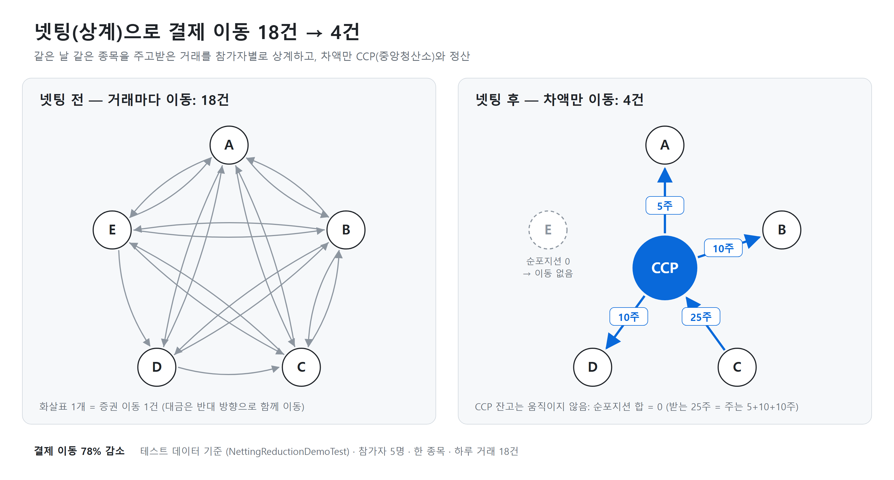
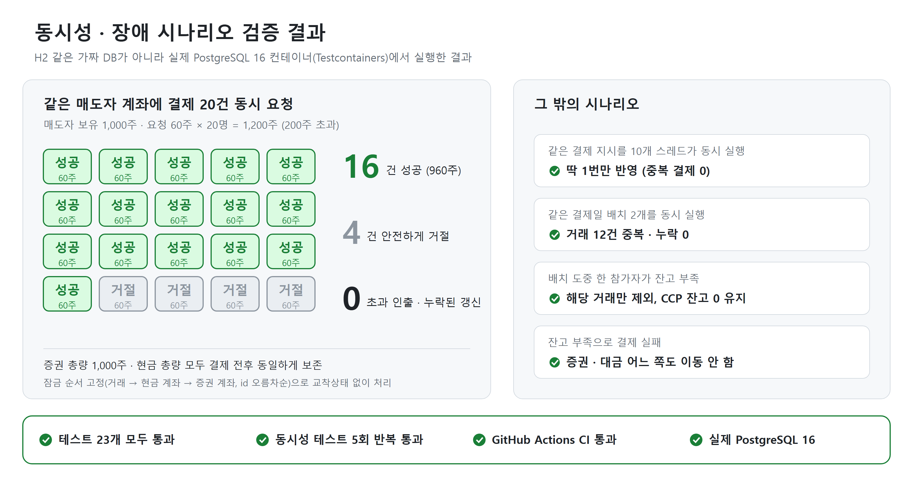

# DVP 증권결제 시뮬레이터

[](https://github.com/2Dokk/dvp-settlement-simulator/actions/workflows/ci.yml)

증권 이전과 대금 지급이 반드시 함께 성공하거나 함께 실패하는 DVP(Delivery versus Payment) 결제를,
넷팅(netting)과 동시성 제어(concurrency control)까지 포함해 시뮬레이션하는 Spring Boot 프로젝트입니다.





## 핵심 아이디어

### 1. DVP 원자성 = 하나의 DB 트랜잭션
`SettlementService.settleInstruction()`은 증권 이전과 대금 지급을 **하나의 `@Transactional` 메서드** 안에서
처리합니다. 먼저 양쪽 잔고를 잠근 뒤, 두 다리(leg)가 모두 가능한지 미리 검증하고, 검증을 통과했을 때만
두 다리를 함께 반영합니다. 검증에 실패하면 어떤 잔고도 건드리지 않은 채 실패 사유만 기록합니다.

### 2. 넷팅 = 배치 전체를 하나의 트랜잭션으로
같은 결제일의 거래들을 참가자×종목 단위로 상계해 순포지션을 계산하고, 임의의 두 참가자를 매칭하는 대신
예약된 **CCP(중앙청산소)** 를 원장상 상대방으로 삼아 정산합니다(`BatchSettlementService`).

**배치는 "계획 → 검증 → 일괄 반영"을 한 트랜잭션 안에서 수행합니다.**

1. 배치에 속한 거래를 선점하고, 관련된 모든 참가자 계좌를 고정 순서로 잠급니다.
2. `BatchNettingPlanner`가 잠근 잔고 스냅샷으로 모든 참가자의 의무(인도할 증권, 종목을 합산한 순지급 현금)를 검사합니다.
3. 부족한 참가자가 있으면 **그 참가자의 거래를 빼고 넷팅을 다시 계산**합니다. 한 명을 빼면 거래 상대방의
   포지션이 바뀌어 새 부족이 생기거나 기존 부족이 해소될 수 있으므로, 한 라운드에 한 명씩(id 순) 제외하며
   남은 거래 집합이 전부 정산 가능해질 때까지 반복합니다. 거래 집합이 매 라운드 줄어들므로 반드시 종료합니다.
4. 남은 거래의 순포지션만 참가자 잔고에 반영하고, 제외된 거래는 원인 참가자와 사유를 기록해 FAILED 처리합니다.

남은 거래 집합의 순포지션은 종목별·현금별로 **합이 항상 0**이므로(모든 거래는 매수자 +, 매도자 − 를 만듦),
**CCP 잔고는 한 번도 움직이지 않고** 원장에만 상대 계정으로 기록됩니다. 반영 직전에 이 합이 0인지 한 번 더
검사하고, 아니면 배치 전체를 롤백합니다.

> **이전 설계와 무엇이 달라졌나**: 처음에는 참가자별 CCP 지시를 각각 별도 트랜잭션으로 실행했습니다.
> 그러다 보니 배치 일부만 실패하면 이미 성공한 지시 때문에 CCP에 **영구 잔여 불균형**이 남았습니다
> (예: 매도자는 CCP에 증권을 인도하고 대금을 받았는데 매수자 결제는 실패 → CCP에 증권 +50, 현금 −500 잔류).
> 지금은 아무것도 움직이기 전에 정산 가능한 거래 집합을 먼저 확정하므로, 부분 실패가 구조적으로 불가능합니다.
> `FailureScenarioTest#partialFailureInABatchLeavesNoCcpResidual`가 같은 시나리오에서 CCP가 0임을 검증합니다.

같은 참가자가 같은 종목을 다른 가격에 사고팔아 "증권은 받는데 현금도 받는" 순포지션이 생겨도,
증권 다리와 현금 다리를 부호대로 따로 반영·기록하므로 정확히 처리됩니다.

### 3. 동시성 제어 = 고정된 순서의 비관적 잠금
모든 경로가 **거래 행 → 현금 계좌(id 오름차순) → 증권 보유(id 오름차순)** 순서로 잠급니다.
단건 결제와 배치 결제가 같은 순서를 공유하므로 서로 교착상태가 생길 수 없습니다.
단건 결제 도중 배치가 같은 거래를 먼저 선점했다면, 단건 쪽이 잠금을 잡은 뒤 이를 감지하고 거절합니다.

계좌·CCP 행 생성은 `INSERT ... ON CONFLICT DO NOTHING`으로 처리해, 동시에 같은 계좌를 만들려는 트랜잭션끼리
유니크 제약 위반으로 실패하지 않습니다.

## 실행

```bash
docker compose up -d
./gradlew bootRun
```

기본 포트는 `8080`입니다.

## 테스트

```bash
./gradlew test
```

GitHub Actions(`.github/workflows/ci.yml`)가 push·PR마다 전체 테스트를 실행합니다. 호스팅 러너에 Docker가
있으므로 Testcontainers 통합 테스트도 실제 PostgreSQL 16 컨테이너에서 돌아갑니다.

**단위 테스트 (DB 불필요)**
- `BatchNettingPlannerTest` — 전원 정산 가능 / 부족 참가자만 제외 / 연쇄 제외 / 한 명씩 제외해야 억울한 제외가
  없는 경우 / 종목 합산 현금 검사 / 가격 차이로 생긴 순포지션
- `NetAccumulatorTest`, `NettingReductionDemoTest` — 넷팅 계산 (18건 → 4건, 78% 감소)

**통합 테스트 — 정상/실패 시나리오**
- `SettlementAtomicityTest` — 단건 결제 성공 시 두 다리가 함께, 실패 시 아무것도 반영되지 않는지
- `FailureScenarioTest` — 현금 부족, 멱등성, 없는 지시 실행, **배치 부분 실패 시 CCP 잔여 불균형 없음**,
  연쇄 제외 시 아무것도 움직이지 않음, 배치가 선점한 거래의 단건 결제 거절
- `NettingBatchTest` — 3자간 넷팅 정산 후 CCP 잔고와 CCP 원장 차변/대변이 모두 0인지

**통합 테스트 — 동시성 시나리오**
- `SettlementConcurrencyTest` — 증권 1000개를 20명이 60개씩 동시에 사려 할 때 정확히 16건만 성공, 총량 보존
- `ConcurrentInstructionExecutionTest` — 같은 지시를 10개 스레드가 동시에 실행해도 한 번만 반영
- `ConcurrentBatchClaimTest` — 같은 결제일 배치 두 개가 동시에 돌아도 거래가 중복·누락 없이 한쪽에만 귀속

## API

| Method | Path | 설명 |
|---|---|---|
| POST | `/participants` | 참가자 등록 (`CCP`는 예약어) |
| POST | `/instruments` | 종목 등록 |
| POST | `/accounts/deposit-cash` | 현금 초기 입금 (DVP 아님, 자본 주입) |
| POST | `/accounts/deposit-securities` | 증권 초기 입고 (DVP 아님, 자본 주입) |
| GET | `/accounts/{participantId}` | 현금·증권 잔고 조회 |
| GET | `/accounts/{participantId}/ledger` | 원장(감사 추적) 조회 |
| POST | `/trades` | 거래 등록 |
| POST | `/trades/{id}/settle` | 넷팅 없이 즉시 단건 DVP 결제 |
| POST | `/settlement-batches/{date}/run` | 해당일 배치 넷팅·정산 |
| GET | `/settlement-batches/{id}` | 배치 결과(순포지션, 거래별 상태·실패 사유) 조회 |

## 알려진 단순화 / 한계

- 통화는 KRW 단일 통화만 지원합니다.
- **제외 정책은 결정적이지만 최적이 아닙니다.** 한 라운드에 id가 가장 작은 부족 참가자를 제외하는 탐욕 방식이라,
  제외 순서에 따라 더 많은 거래를 살릴 수 있는 조합을 놓칠 수 있습니다. 정산 가치를 최대화하는 문제는 실제
  CSD에서 별도 최적화 알고리즘으로 풉니다.
- 제외된 거래는 FAILED로 끝납니다. 실제 결제기관처럼 다음 결제 사이클로 재투입(recycling)하지는 않습니다.
- 배치 하나가 관련 계좌 잠금을 트랜잭션 끝까지 유지하므로, 참가자를 공유하는 배치끼리는 직렬로 처리됩니다.
